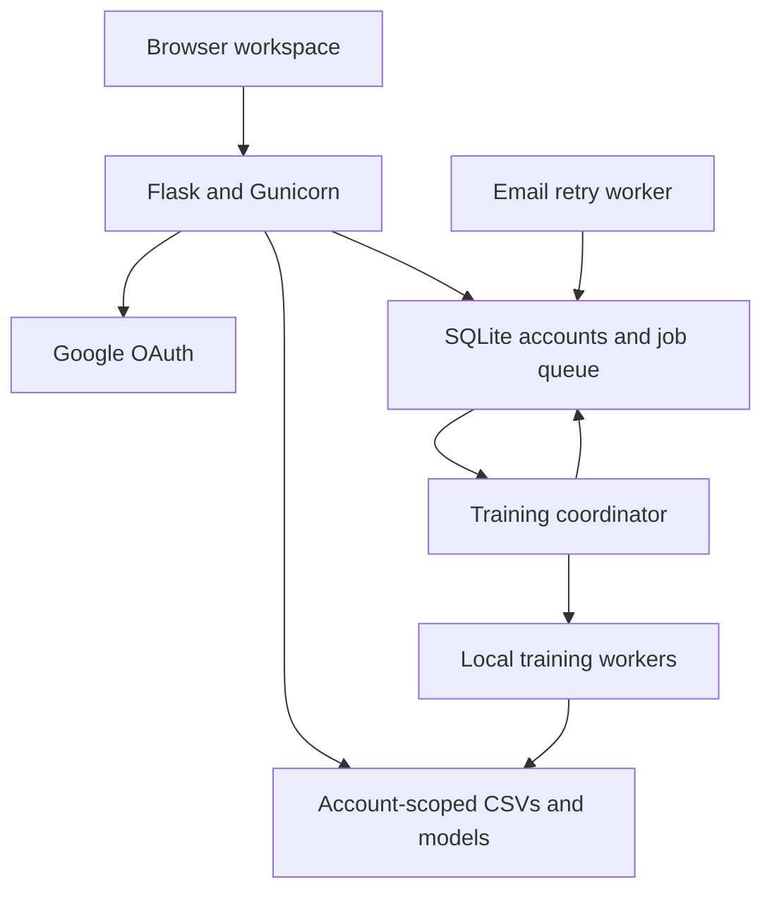

# Synaptiforge

**Train binary classifiers from CSV data, recover interrupted jobs, and export predictions through a private web workspace.**

[Open live demo](https://synaptiforge.onrender.com) · [Demo walkthrough](DEMO_GUIDE.md) · [Deployment notes](DEPLOYMENT.md)

Built with Python, Flask, scikit-learn, SQLite, multiprocessing, Google OAuth, and Gunicorn. Parallel training runs on a single server.


## Try the live demo

1. Sign in with Google.
2. Download the sample CSV and upload it under **Train**.
3. Select **outcome** and **1 worker**, then start training.
4. Open **My Models** to inspect the result and select a completed model.
5. Open **Predict**, download its input template, and upload numeric rows to export predictions.

The free Render instance sleeps when idle and may take about a minute to wake. Accounts, uploads, checkpoints, and models are temporary and can disappear after a restart or redeploy. Google sign-in is configured; email verification, password reset delivery, and welcome emails are not configured on the hosted demo. Failure simulation is available locally with Demo Mode enabled.

## Engineering highlights

| Area | Implementation |
| --- | --- |
| Job execution | SQLite-backed queue with one active training job across the service |
| Parallelism | Selectable 1, 2, or 4 local worker processes |
| Recovery | Per-round checkpoints, pause/resume, cancellation, and worker failure simulation |
| Privacy | Account-scoped uploads, jobs, models, and prediction selection |
| Predictions | CSV templates, batch classification, and downloadable results |
| Deployment | Gunicorn and supervised background processes on Render |

## Architecture



All app processes share one storage directory. The hosted demo uses temporary storage; durable deployment requires persistent storage. This architecture does not distribute training across machines. More workers are not guaranteed to be faster, and no benchmark speedup is claimed.

A small-beta machine-learning app for numeric CSV data and binary classification. Users train with parallel processes on one server, save models, resume checkpoints, and download CSV predictions. Each account has private uploads, jobs, models, checkpoints, and model selection.

## Start locally

Stop the previous server in its terminal before starting the new launcher:

```bash
cd ~/synaptiforge
source venv/bin/activate
python -m pip install -r requirements.txt
python run_local.py
```

Open http://127.0.0.1:5000. The launcher runs the web app, durable training queue, and email retry worker together. Use Control+C to stop them. Starting `python app.py` alone serves the website but does not run queued training or background email retries.

For a fresh copy, create a Python 3.14 virtual environment and install `requirements.txt`. Original demonstration model files are no longer required to start the app. Copy `.env.example` to `.env` only if `.env` does not already exist; follow `AUTH_SETUP.md` for Google and Gmail setup. Existing local credentials remain in `.env`.

## Four sections

- **Train:** upload CSV, choose the target, choose 1/2/4 workers, and train for 10 rounds.
- **My Models:** see private jobs, select a model, rename jobs, cancel training, resume available checkpoints, or permanently delete an inactive job after confirmation.
- **Predict:** download a blank template, upload CSV rows, and download predictions. There are no individual feature input boxes or separate 30-feature demo model.
- **Account:** update your name, see verification/Google status and storage, and use password recovery.

The latest completed training result and the selected prediction model can be different.

## CSV requirements and limits

Default limits: 5 MB per upload, 10,000 rows, 50 numeric input columns, 100 MB private storage per account, 100 saved jobs, and one active or queued job per account. The queue runs one job at a time across all accounts. A job has a five-minute execution limit. These are small-beta limits, configurable through environment variables.

Training needs at least ten rows, no missing or non-finite values, and a target with exactly two values and at least two rows per class. Target labels are limited to 120 characters. Column names must be unique, nonempty, at most 80 characters, and cannot begin with spreadsheet formula markers. Inputs are numeric; targets can use two text labels. Checkpoints are saved automatically after each completed round.

Use **Download Sample CSV** for generic `feature_1`, `feature_2`, and `outcome` columns. The sample demonstrates the workflow; it is not a real business dataset.

Prediction CSVs must contain the selected model's required columns, in any order. Other columns are preserved. Downloads add `predicted_<target>`, `prediction_confidence_percent`, and `prediction_model_job`; numbered suffixes avoid overwriting existing columns. Text cells that could be interpreted as spreadsheet formulas are escaped for safer spreadsheet opening.

## Demo Mode

The Train page has an optional Demo Mode section. Enable it to simulate Worker 3 failure in Round 4 with four workers, pause after Round 4, or do both. Ordinary training ignores demo flags unless Demo Mode is explicitly enabled. Resume through My Models. `ALLOW_DEMOS=false` hides and disables these options for a public service.

## Accounts

Password accounts verify email before workspace access. Google accounts have verified email. Verification links expire in 24 hours; reset links expire in 30 minutes; both are single-use. Reset invalidates prior sessions. Password visibility buttons are available on login and reset forms. Gmail uses verified STARTTLS; welcome and verification/reset delivery failures remain queued for retry.

Historical pre-login jobs were copied into the original account. Those originals remain as local backup artifacts outside private web access. New accounts start empty.

## Verification

```bash
python tests/test_release.py
```

The guarded test script uses temporary storage and test accounts, sends no real email, and verifies queue execution, limits, normal/demo separation, recovery, pause/resume, cancellation, renaming, confirmed deletion, predictions, and account boundaries. Multiprocessing is launched from real `.py` files, not stdin or heredocs.

## Production

See `DEPLOYMENT.md` for Docker, persistent storage, HTTPS, Google callback/email URLs, and small-beta hosting instructions. The package uses Gunicorn plus training and mail workers. Do not publish the development server or include `.env`, accounts, tokens, or model/data folders in a source upload.

This is a single-server, single-instance beta. It does not train across multiple computers or provide autoscaling. There is no guarantee that four workers are faster than one. Evaluate predictions with representative unseen data before using them for real decisions.

Public help and privacy pages are available from login and the workspace. Production needs a monitored support address. An encrypted daily backup service starts with the app; recovery instructions and the distinction between same-disk snapshots and off-host copies are in DEPLOYMENT.md.
